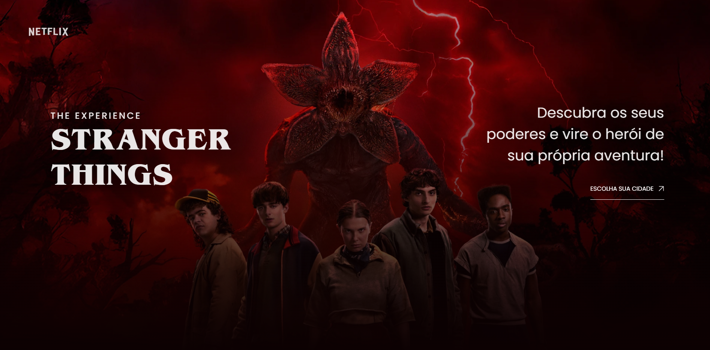

<h1 align="center"> DevArt - Stranger Things 🔦</h1>

Landing page da atração Stranger Things: The Experience, com visual cinematográfico e animações de scroll

  <a href="#-tecnologias">Tecnologias</a>&nbsp;&nbsp;&nbsp;|&nbsp;&nbsp;&nbsp;
  <a href="#-projeto">Projeto</a>

  
 

## 🚀 Tecnologias

Esse projeto foi desenvolvido com as seguintes tecnologias:

- HTML e CSS
- JavaScript
- GSAP (ScrollSmoother, ScrollTrigger e SplitText)
- Figma
- Git e Github

## 💻 Projeto

- Landing page da atração "Stranger Things: The Experience" (Netflix x Fever), feita a partir do layout do DevArt de Gustavo Campelo sobre a 5ª temporada da série, com identidade visual sombria e cinematográfica e totalmente responsiva.

- As animações de scroll e de texto foram feitas com GSAP, usando ScrollSmoother para a rolagem suave, ScrollTrigger para disparar as cenas e SplitText para animar os títulos, com fundos específicos para desktop e mobile.

<h2 align="center">📌 Desenvolvedores</h2>

<table align="center">
  <tr>
    <td align="center">
      <a href="https://github.com/rebellatoGui" title="GitHub">
         
        
          <b>Guilherme Rebellato</b>
        
      </a>
    </td>
  </tr>
</table>

 

---

Feito com ♥ por rebellatoGui

